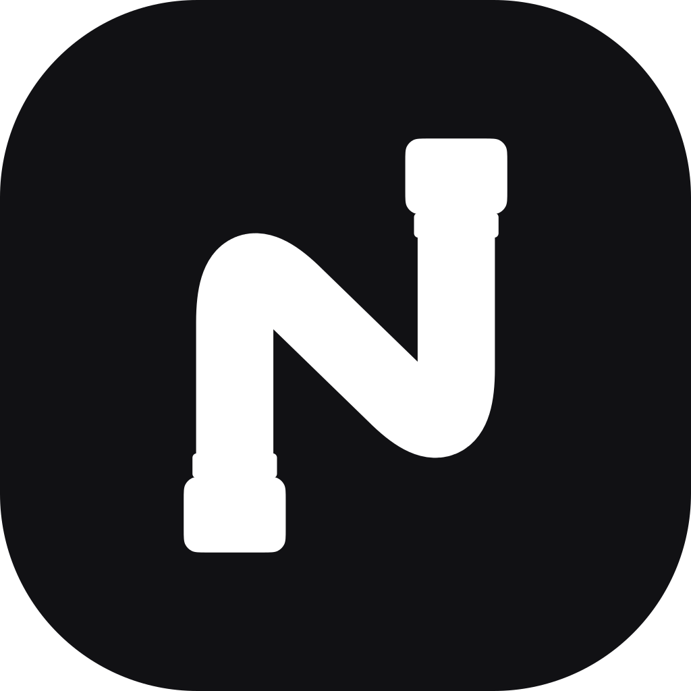
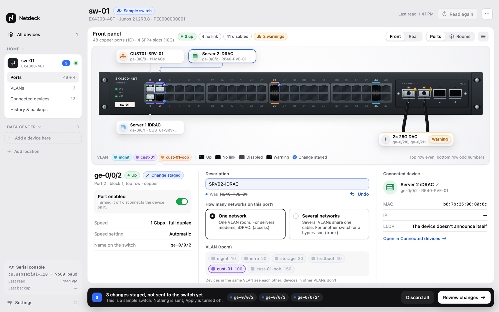
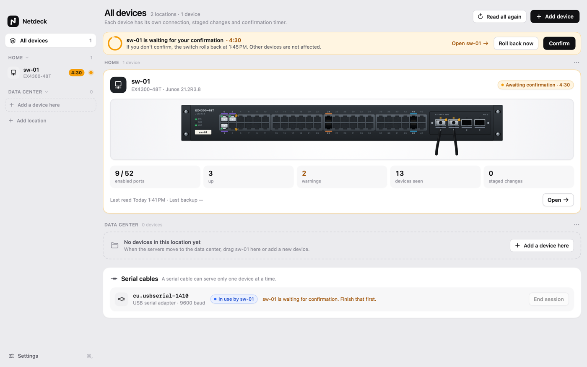
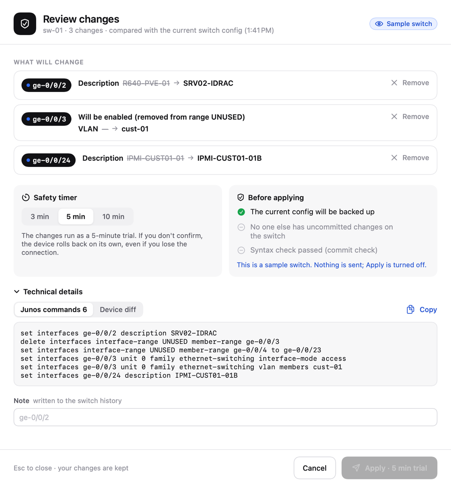

<p align="center">
  
</p>

<h1 align="center">Netdeck</h1>

<p align="center">
  <strong>See your network gear the way it looks on the rack, and change it without fear.</strong>
</p>

<p align="center">
  A native macOS app for switches, routers, servers and NAS. Real front panels, plain-language changes,
  and a safety timer on the device itself for every change you apply.
</p>

<p align="center">
  
  
  
  
  
  
</p>

<p align="center">
  
</p>

Netdeck connects over a serial console, SSH or HTTPS, draws the device's real front and rear panels, shows
what is plugged into every port, and turns your edits into a reviewed, time-boxed change that the device
rolls back on its own if you don't confirm it.

> **Status: early development.** The Junos core is tested against real hardware (EX4300-48T). The drivers
> for the other platforms are written from vendor documentation and covered by unit tests on synthetic
> captures; they have not met real hardware yet. Try them with `netdeck-probe` first (it never applies
> anything) and send captures.

---

## Why

Most small teams and homelab owners manage switches by pasting CLI commands from notes. A typo in the
wrong `interface-range`, or one forgotten `commit`, takes a server off the network, and the person who
made the change is often the one locked out of fixing it.

Netdeck keeps the device's own safety net in place and puts a clear picture on top of it:

- **Know what you have.** Every port, its VLAN, link state, the module in each cage, and the MAC
  addresses and LLDP neighbours behind it, drawn on a faithful faceplate.
- **Say what you want, not how.** "Open port 3 for the management cable" becomes the right `set`
  and `delete` statements, including splitting the disabled-ports range it belongs to.
- **Apply without fear.** Every change goes out under the device's own timer (`commit confirmed` on
  Junos, a revert timer, checkpoint or restore job elsewhere). If something breaks and you can't
  confirm, for example because the change cut your VPN path, the device returns to its previous
  configuration by itself.

## Features

| | Status |
|---|---|
| Serial console (USB), SSH and HTTPS API connections | Done |
| Login handling for console, shell and CLI prompts; automatic hand-over to the right platform | Done |
| Ports, VLANs, MAC table, LLDP, hardware, optics, commit history | Done |
| Plain-language change plan (edit ports and VLANs) | Done |
| Device-side safety timer on every apply, one-click confirm or revert | Done |
| Rear QSFP+ role changes (Virtual Chassis port ↔ network port) on the EX4300 | Done |
| Automatic config backups before every change | Done |
| Device auto-detection (vendor, model, OS) | Done |
| Front panels drawn per model (100 known panels, generic layout for the rest) | Done |
| Health, storage, sensors and interfaces of servers and NAS (read only) | Done |
| Server power actions over Redfish (shut down, restart, force off...), each after a confirmation | Done |
| Multiple devices grouped by location, global "awaiting confirmation" banner | Done |
| Built-in SSH client that also reaches older devices (legacy key exchange, RSA host keys, CBC ciphers), App Sandbox ready | Done |
| Interface in 34 languages | Done |

## A closer look

<table>
  <tr>
    <td width="55%" valign="top">
      
      <br><sub><b>Every change runs on a timer.</b> Until you confirm, the device keeps the way back; the banner
      counts down and one click confirms or rolls back.</sub>
    </td>
    <td width="45%" valign="top">
      
      <br><sub><b>Review before you apply.</b> Changes in plain words, checks run first, and the exact commands
      the device receives.</sub>
    </td>
  </tr>
</table>

## Supported devices

| Platform | Devices | Safety net when you apply | Tested on hardware |
|---|---|---|---|
| Juniper Junos | EX, QFX, SRX (ports, VLANs, security zones), MX (ports) | `commit confirmed` | EX4300-48T, Junos 21.2 |
| Cisco IOS / IOS-XE | Catalyst switches | `configure terminal revert timer` (turns the config archive on if needed), `write memory` only after you confirm | Not yet |
| MikroTik RouterOS 7 | CRS switches, CCR / RB / hEX routers (bridge VLAN filtering) | An undo script and a scheduler on the router run unless you confirm | Not yet |
| Ubiquiti EdgeOS | EdgeRouter | `commit-confirm` (the router restarts with its saved configuration if not confirmed), `save` only after you confirm | Not yet |
| HPE Aruba AOS-S (ProCurve) 16.05+ | 2530, 2540, 2920, 2930F/M, 3810M, 5400R (older firmware read only) | `cfg-backup` to flash, then a one-shot job runs `cfg-restore` after N minutes without a reboot (HPE's automatic-rollback recipe), `write memory` only after you confirm | Not yet |
| TP-Link Omada / JetStream | SG2xxx, SG3xxx, SX3xxx and T-series managed switches in standalone mode (controller-managed switches read only) | `reboot-schedule in N` without saving: if you don't confirm, the switch restarts with its saved configuration (offline for a few minutes). A refused command or *Undo now* puts the old settings back with commands, without a restart. Applies only when nothing else is unsaved; `copy running-config startup-config` only after you confirm | Not yet |
| HPE Aruba AOS-CX 10.06+ | 6000–10000 series switches | `checkpoint auto N` (the switch restores its previous configuration if not confirmed; Netdeck also keeps its own checkpoint to undo at once), `write memory` only after you confirm | Not yet |
| Fortinet FortiOS | FortiGate and FortiWiFi firewalls (ports with their addresses, VLAN interfaces, zones and ARP neighbours; configuration kept in History & backups) | Read only: a firewall mistake can cut off the connection (often a VPN through it) that would undo it, and FortiOS has no rollback timer without a restart | Not yet |
| Dell iDRAC (Redfish) | PowerEdge servers | Read only, power actions after confirmation | Not yet |
| Redfish BMC (HPE iLO, Supermicro, Lenovo XCC) | Servers | Read only, power actions after confirmation | Not yet |
| Synology DSM, TrueNAS | NAS | Read only | Not yet |

Other devices are recognised when possible and shown with basic information. HTTPS devices with a
self-signed certificate are trusted on first use and pinned, like SSH host keys.

## Safety model

Netdeck is built so that a mistake costs you minutes, never a site visit.

1. **Read-only by default.** Connecting, refreshing and previewing never change the device.
2. **Preview on the device itself** where the platform has a candidate configuration (Junos, EdgeOS): your
   edits are loaded, the device reports its own diff and check result, and the candidate is discarded again.
   Elsewhere the review shows the exact commands the device will receive.
3. **Timed apply.** Every change goes out under a timer on the device (see *Supported devices* above): Junos
   `commit confirmed`, IOS `revert timer`, AOS-CX `checkpoint auto`, an AOS-S restore job, a RouterOS undo
   script, EdgeOS `commit-confirm`, a TP-Link scheduled restart. Until you press *Confirm*, the device undoes
   the change on its own when the timer runs out, even if Netdeck or your connection dies. Where a platform
   can't do this (AOS-S before 16.05, AOS-CX before 10.06, TP-Link switches managed by an Omada controller,
   FortiGate firewalls),
   Netdeck only reads. EdgeOS and TP-Link undo by restarting with the saved configuration; the review says so
   before you apply.
4. **Saved only after you confirm.** The startup configuration is written after *Confirm*, never before;
   Netdeck answers "no" when a device asks to save on logout.
5. **Backups first.** The current configuration is saved locally before every apply or rollback.
6. **Hands off other people's work.** If the device already holds uncommitted changes from another
   session, or another change is still waiting for confirmation, Netdeck stops and shows it instead of
   building on top of it.
7. **Clean exits.** Serial console sessions are logged out when Netdeck disconnects.

## Requirements

- macOS 15 or later
- Xcode 16 or later (Swift 6 toolchain) to build from source
- A USB serial console cable, or SSH access to the device's management interface (password login).
  The built-in SSH client prefers modern algorithms (Curve25519/ECDH, Ed25519/ECDSA host keys, AES-GCM) and
  falls back to the older ones that devices such as Catalyst IOS 12.2/15.x still offer (Diffie-Hellman
  group 14/1, RSA host keys, AES-CTR/CBC, 3DES, HMAC-SHA1). The connection badge then reads "SSH, older
  algorithms" and its tooltip lists what was negotiated.

## Build and run

```sh
git clone <this repository>
cd netdeck
swift test                     # run the test suite
scripts/make-app.sh --open     # build build/Netdeck.app and open it
scripts/make-app.sh --sandbox  # same, signed with Resources/Netdeck.entitlements (App Sandbox)
```

`scripts/make-app.sh --notarize` builds the release download. It signs the app with a Developer ID certificate
from the keychain, has Apple notarize it and staples the ticket. Before the first run, create a notarytool
profile once with `xcrun notarytool store-credentials netdeck`.

### Field tool

`netdeck-probe` exercises the same core from the terminal. It is useful for checking a new device or
firmware before using the app. It never commits.

```sh
swift build --product netdeck-probe

# Read everything Netdeck shows (the platform is detected; --platform cisco|mikrotik|edgeos|... forces it)
NETDECK_PASSWORD=... .build/debug/netdeck-probe --serial /dev/cu.usbserial-XXXX --user root snapshot
NETDECK_PASSWORD=... .build/debug/netdeck-probe --api https://192.0.2.30 --user root snapshot

# Ask the device what a change would do, then throw it away
NETDECK_PASSWORD=... .build/debug/netdeck-probe --ssh 192.0.2.10 --user admin \
  preview "set interfaces ge-0/0/2 description uplink"
```

## How it works

```
Sources/
  NetdeckCore/            UI-independent core (fully unit-tested)
    Transport/            Serial console (termios, ports found through IOKit) and SSH (embedded SwiftNIO SSH
                          client; the system ssh is optional outside the Mac App Store)
    CLI/                  Text CLI session shared by the non-Junos drivers (prompts come from a dialect)
    Drivers/              DeviceDriver protocol, driver factory, per-platform change traits
    Junos/                CLI session, output parsers, config model, change planner, driver
    Cisco/ MikroTik/ EdgeOS/ Aruba/ TPLink/  Dialect, parsers, change planner and driver per platform
    Fortinet/             FortiOS dialect, parsers and a read-only driver
    API/                  HTTPS client with certificate pinning; Redfish, Synology and TrueNAS readers
    Model/                Snapshots, ports, device kinds and platforms, auto-detection, faceplate catalog
    Session/              Observable per-device state for the UI
    Support/              Backups, device list, Keychain, localization
  Netdeck/                SwiftUI app
  netdeck-probe/          Command-line field tool
Vendor/
  swift-nio-ssh/          SwiftNIO SSH with legacy algorithms for older devices (changes in PATCHES.md)
Tests/
  NetdeckCoreTests/       Parser, planner, session and detection tests
    Fixtures/             Real console captures (anonymized); synthetic/ holds captures written
                          from vendor documentation until real ones replace them
```

Netdeck talks to devices the same way you would: through their CLI. It reads with `show` commands,
parses the text (including fixed-width tables), and writes with plain `set`/`delete` statements, so
every change is visible as the exact commands the device received.

## Privacy

- Device passwords are stored in the macOS Keychain, never on disk.
- Netdeck only connects to the devices you add. There is no telemetry and no account.
- Backups, device settings and trusted SSH host keys stay in `~/Library/Application Support/Netdeck`
  (inside the app's container, `~/Library/Containers/io.github.subasioguz.netdeck/Data/...`, for the sandboxed build).

## Localization

English is the development language. Every user-facing string is looked up with `t("English text")`,
and translations live in `Sources/NetdeckCore/Resources/<language>.lproj/Localizable.strings`.
The interface is translated into 33 languages besides English (Arabic and Hebrew are shown left to right).
To add a language, copy `tr.lproj`, translate the values, and add the code to `CFBundleLocalizations` in
`Resources/Info.plist`. `python3 -I scripts/check-l10n.py --strings <table>` checks a table against the code.

## Contributing

Bug reports with console output are very welcome, especially from devices and firmware versions not
listed above. When sharing captures, remove passwords and hashes, and replace serial numbers and MAC
addresses (keep column alignment in fixed-width tables). See `Tests/NetdeckCoreTests/Fixtures` for
examples.

## License

Copyright 2026 Oğuzhan Subaşı.

Licensed under the [Apache License, Version 2.0](LICENSE). You may use, modify and distribute Netdeck,
including commercially, under the terms of that license. The license does not grant rights to the
Netdeck name or logo.

Netdeck changes the configuration of live network equipment. It is provided "as is", without warranty of
any kind (sections 7 and 8 of the license). Try it on a lab or non-critical device first, and keep your own
backups.

Juniper, Junos, Cisco, IOS, HPE, Aruba, ProCurve, iLO, MikroTik, RouterOS, Ubiquiti, EdgeOS, TP-Link, Omada,
JetStream, Fortinet, FortiGate, FortiWiFi, FortiOS, Dell, iDRAC, Redfish,
Supermicro, Lenovo, Synology and TrueNAS are trademarks of their respective owners. Netdeck is an independent
project, not affiliated with or endorsed by any of them; the names are used only to say which devices it
works with.

`Vendor/swift-nio-ssh` is [SwiftNIO SSH](https://github.com/apple/swift-nio-ssh) by Apple and the SwiftNIO
project authors, also under the Apache License 2.0, with the changes listed in its `PATCHES.md`.
